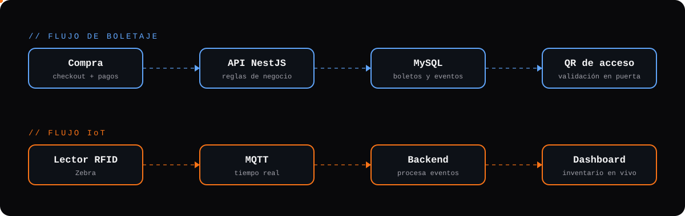

 

---

## `01` · Sobre mí

Construyo sistemas que conectan software con el mundo real: plataformas de boletaje con pagos y validación por QR, APIs empresariales y soluciones con hardware (RFID, MQTT) en tiempo real.

## `02` · Stack en órbita

## `03` · Cómo fluyen mis sistemas

## `04` · Proyectos destacados

<table>
<tr>
<td width="50%" valign="top">

### 🎟️ [Boletus](https://www.boletus.mx/)
Venta de boletos, validación de accesos por QR, administración de eventos, pagos y analítica.

`NestJS` `React` `MySQL` `Pagos` `QR`

**[Explorar proyecto ↗](https://www.boletus.mx/)**

</td>
<td width="50%" valign="top">

### 🎫 [WeekendMX](https://weekendmx.com/)
Descubre conciertos, eventos y espectáculos, optimizado para búsqueda orgánica.

`Next.js` `SEO` `Desarrollo web`

**[Explorar proyecto ↗](https://weekendmx.com/)**

</td>
</tr>
<tr>
<td width="50%" valign="top">

### 💻 [herzago.dev](https://herzago.dev/)
Portafolio y marca personal: soluciones digitales, casos y proyectos.

`Diseño` `Frontend` `Ingeniería`

**[Visitar portafolio ↗](https://herzago.dev/)**

</td>
<td width="50%" valign="top">

### ⚙️ Sistemas empresariales
Inventarios, lectores RFID, integración de hardware y comunicación en tiempo real.

`NestJS` `SQL` `MQTT` `RFID`

*Proyectos profesionales privados*

</td>
</tr>
</table>

## `05` · Demo en movimiento

<!--
  VIDEO: edita este README en github.com, arrastra tu .mp4 (menos de 10 MB) al editor
  y GitHub pegará una URL https://github.com/user-attachments/assets/... en una línea sola.
  Esa línea se reproduce como video dentro del perfil. Borra este comentario cuando lo pegues.

  GIF: sube tu .gif a la carpeta assets/ y usa:
  
-->

## `06` · Actividad

  

  

## `07` · Escuchando ahora

---

**DIEGO HERBERT** · Ingeniería de software · México 🇲🇽 · [herzago.dev ↗](https://herzago.dev)

